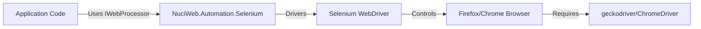
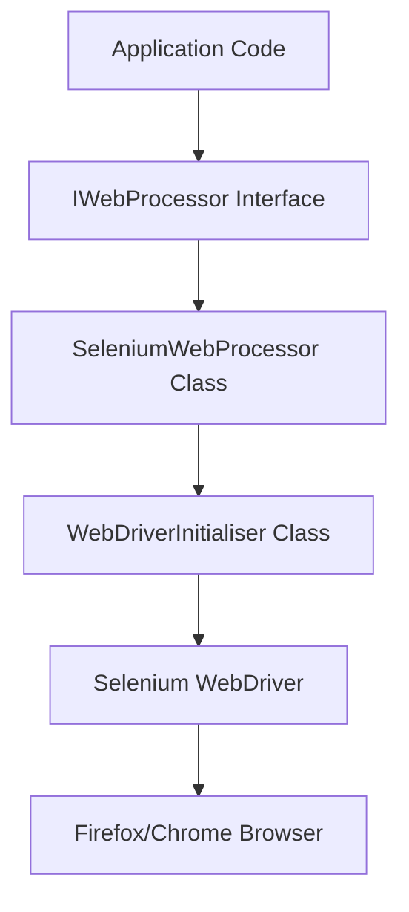
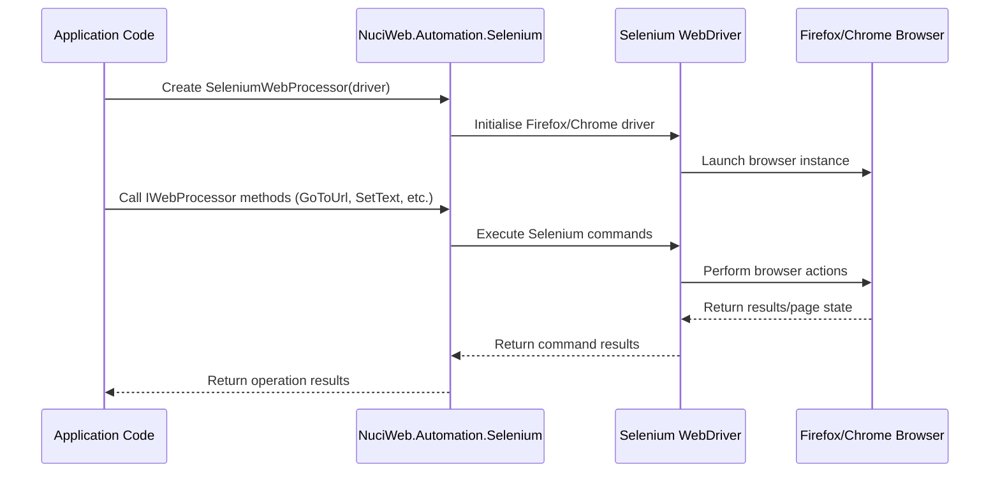
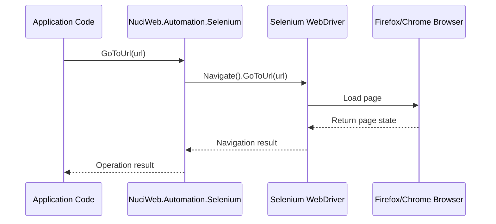
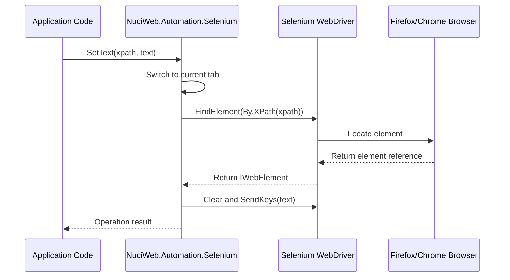
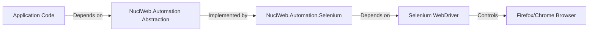

# NuciWeb.Automation.Selenium Architecture

This document describes the current architecture of the NuciWeb.Automation.Selenium library, which provides a Selenium-based implementation for the NuciWeb.Automation abstractions.

## 📑 Table of Contents
- [Purpose](#purpose)
- [System Context](#system-context)
- [Architectural Style](#architectural-style)
- [Runtime Flow](#runtime-flow)
- [Components](#components)
- [Architectural Areas](#architectural-areas)
- [Interfaces and Integrations](#interfaces-and-integrations)
- [Key Flows](#key-flows)
- [Domain-Specific Concerns](#domain-specific-concerns)
- [Cross-Cutting Concerns](#cross-cutting-concerns)
- [Dependency Direction and Rules](#dependency-direction-and-rules)
- [External Dependencies](#external-dependencies)
- [Deployment and Operations](#deployment-and-operations)
- [Compatibility Contracts](#compatibility-contracts)
- [Testing and Verification](#testing-and-verification)
- [Design Constraints](#design-constraints)
- [Extension Points](#extension-points)
- [Related Documentation](#related-documentation)

## 🎯 Purpose

NuciWeb.Automation.Selenium provides a Selenium WebDriver implementation of the `IWebProcessor` interface from the NuciWeb.Automation abstraction layer. It enables projects to drive real browsers through a clean abstraction while keeping higher-level automation logic independent from Selenium-specific details. The library targets .NET 10.0 and supports Firefox and Chrome browsers.

## 🌐 System Context

The library operates as a dependency for applications requiring web automation. It interacts with:
- **Application Code:** Uses the library through the `IWebProcessor` interface
- **Selenium WebDriver:** Direct dependency for browser automation
- **Browser Drivers:** External `geckodriver` (Firefox) or ChromeDriver executables
- **Web Browsers:** Firefox or Chrome browsers controlled via WebDriver



The principal external boundaries are:
- **Application Interface:** Consumes `IWebProcessor` interface for automation operations
- **Selenium Boundary:** Depends on Selenium.WebDriver and Selenium.Support packages
- **Driver Executable Boundary:** Requires external browser driver executables (`geckodriver` or ChromeDriver)
- **Browser Boundary:** Controls actual Firefox or Chrome browser instances

## 🏗️ Architectural Style

The library follows a **Layered Abstraction** architectural style:
- **Abstraction Layer:** Implements the `NuciWeb.Automation.IWebProcessor` interface
- **Implementation Layer:** Contains Selenium-specific logic in `SeleniumWebProcessor`
- **Initialisation Layer:** Provides browser driver setup via `WebDriverInitialiser`

This separation ensures that application code depends only on the abstraction layer, making it possible to swap implementations without changing automation logic.



The principal architecture boundaries are:
- **Abstraction Boundary:** `IWebProcessor` interface separates application from implementation
- **Selenium Boundary:** Encapsulates all Selenium-specific code
- **Driver Boundary:** Isolates browser driver initialisation logic

## 🔄 Runtime Flow



The principal runtime sequence is:
1. **Initialisation:** Application creates `SeleniumWebProcessor` with a WebDriver instance
2. **Driver Setup:** `WebDriverInitialiser` creates configured Firefox or Chrome driver
3. **Operation Execution:** Application calls `IWebProcessor` methods through the processor
4. **Command Translation:** Processor translates abstraction calls to Selenium WebDriver commands
5. **Browser Interaction:** WebDriver executes commands against the actual browser instance
6. **Result Return:** Results flow back through the layers to the application

## 🧩 Components

| Component | Responsibility | Principal Dependencies | Lifetime or Ownership |
|-----------|----------------|------------------------|-----------------------|
| `SeleniumWebProcessor` | Implements `IWebProcessor` interface using Selenium WebDriver | Selenium.WebDriver, Selenium.Support | Transient - created per processor instance |
| `WebDriverInitialiser` | Creates configured Firefox or Chrome WebDriver instances | Selenium.WebDriver, Selenium.Support, NuciWeb.HTTP | Static utility - no instantiation needed |
| `NuciWeb.Automation.IWebProcessor` | Defines the web automation processor abstraction | None (interface) | Abstraction - implemented by SeleniumWebProcessor |

## 🗂️ Architectural Areas

### Core Library

Paths:
- `NuciWeb.Automation.Selenium/SeleniumWebProcessor.cs`
- `NuciWeb.Automation.Selenium/WebDriverInitialiser.cs`

Responsibilities:
- Implements the `IWebProcessor` interface using Selenium WebDriver
- Provides browser driver initialisation for Firefox and Chrome

Boundary rules:
- Application code depends only on `NuciWeb.Automation.IWebProcessor`, not on Selenium types directly
- `SeleniumWebProcessor` depends on Selenium.WebDriver and Selenium.Support
- `WebDriverInitialiser` depends on Selenium.WebDriver, Selenium.Support, and NuciWeb.HTTP

## 🔌 Interfaces and Integrations

| Interface or Integration | Direction | Contract | Owner | Failure Semantics |
|--------------------------|-----------|----------|-------|-------------------|
| `IWebProcessor` | Inbound | NuciWeb.Automation processor interface | NuciWeb.Automation | Translation of Selenium exceptions to abstraction-level failures |
| Selenium WebDriver | Outbound | WebDriver protocol via HTTP | Selenium.WebDriver | Retry, fallback, or termination based on command type |

## 🔀 Key Flows

### Browser Navigation



Application calls `GoToUrl` through `IWebProcessor`. The processor navigates the WebDriver to the requested URL, retrying on Chromium error pages, and returns once the page loads successfully or throws after exhausting retries.

### Element Interaction



Application calls element interaction methods through `IWebProcessor`. The processor switches to the current tab, locates the element by XPath with retry logic, performs the action, and returns the result.

## ⚙️ Browser Automation

The library automates Firefox and Chrome browsers through Selenium WebDriver. Browser selection is determined at runtime by checking for the presence of `geckodriver` at `/usr/bin/geckodriver`. When present, Firefox is used; otherwise Chrome is used. Both drivers are configured with `PageLoadStrategy.None`, a configurable page load timeout, maximized window, and quieter logging. Headless mode is enabled when debug mode is disabled.

## ⚙️ Domain-Specific Concerns

XPath-based element location throughout the processor API. The processor switches to the current tab before resolving elements. Navigation includes retry logic and a basic Chromium error-page check before failing. Headless mode is available only when debug mode is disabled.

## 🧭 Dependency Direction and Rules

The library follows strict dependency direction rules to maintain separation of concerns:
- **Permitted Dependency:** Application → NuciWeb.Automation.Selenium → Selenium.WebDriver
- **Permitted Dependency:** NuciWeb.Automation.Selenium → NuciWeb.Automation (abstraction only)
- **Prohibited Dependency:** Selenium.WebDriver → NuciWeb.Automation.Selenium (no reverse dependencies)
- **Prohibited Dependency:** Application → Selenium.WebDriver (bypassing abstraction layer)



The principal dependency rules are:
- **Permitted dependency:** Application code depends only on the abstraction layer (`NuciWeb.Automation`)
- **Permitted dependency:** Implementation depends on Selenium WebDriver for browser automation
- **Prohibited dependency:** No direct dependencies from application to Selenium WebDriver
- **Permitted dependency:** Implementation depends on NuciWeb.HTTP for user agent fetching

## 📦 External Dependencies

| Dependency | Responsibility | Integration Boundary | Architectural Consequence |
|------------|----------------|----------------------|---------------------------|
| Selenium.WebDriver | Browser automation protocol implementation | `SeleniumWebProcessor` class | Direct coupling to WebDriver API surface |
| Selenium.Support | WebDriver support utilities (Select, Actions, etc.) | `SeleniumWebProcessor` class | Direct coupling to support utility APIs |
| NuciWeb.Automation | Web automation processor abstraction | `IWebProcessor` interface | Abstraction boundary - implementation must conform |
| NuciWeb.HTTP | User agent fetching | `WebDriverInitialiser` class | External HTTP dependency for user agent resolution |

## 🚀 Deployment and Operations

The library is distributed as a NuGet package and designed for integration into .NET applications:

| Concern | Current Design | Architectural Consequence |
|---------|----------------|---------------------------|
| Packaging | Distributed as NuGet package (`NuciWeb.Automation.Selenium`) | Enables easy consumption via standard .NET package management |
| Target Framework | .NET 10.0 | Requires modern .NET runtime for execution |
| Platform Support | Cross-platform (Windows, Linux, macOS) | Supports deployment on any .NET 10.0 compatible platform |
| External Dependencies | Requires browser drivers (`geckodriver` or ChromeDriver) | Deployment must include appropriate browser drivers |
| Versioning | Semantic versioning with GPL-3.0-or-later license | Clear version tracking and open-source licensing |

The library operates as a dependency with no persistent state, network listeners, or long-running processes. All state is managed through the WebDriver instances created by consumers.

## 🛡️ Compatibility Contracts

| Contract | Owner | Invariant | Verification | Change Policy |
|----------|-------|-----------|--------------|---------------|
| `IWebProcessor` interface | NuciWeb.Automation | Method signatures and semantics must remain stable | Compile-time interface conformance | Breaking changes require major version bump |
| Selenium WebDriver protocol | Selenium project | WebDriver command/response format | Runtime execution against browser drivers | Version pinning to 4.5.1 for stability |

## ✅ Testing and Verification

Verification occurs at multiple levels to ensure correctness:

- **Unit Tests:** Test individual methods in `SeleniumWebProcessor` and `WebDriverInitialiser` using mocking frameworks
- **Integration Tests:** Validate end-to-end browser automation scenarios with actual browser instances
- **Compile-time Verification:** Strong typing and interface contracts prevent incorrect usage
- **Runtime Verification:** Null checks and exception handling ensure robust operation

Execute the principal automated verification with:

```bash
dotnet test
```

The architecture boundaries each verify:
- **Component Level:** Unit tests validate `SeleniumWebProcessor` and `WebDriverInitialiser` behavior
- **Integration Level:** Browser automation tests validate end-to-end functionality
- **Contract Level:** Interface implementation ensures adherence to `IWebProcessor` contract
- **Dependency Level:** Package restoration validates external dependency compatibility

## ⚠️ Design Constraints

Current trade-offs and deliberate exclusions in the architecture:

- **Browser Support:** Limited to Firefox and Chrome due to driver availability and testing constraints
- **Headless Mode:** Available only when debug mode is disabled, reducing resource usage in CI/CD
- **Selenium Version:** Locked to 4.5.1 for stability and compatibility with NuciWeb.Automation
- **Abstraction Faithfulness:** Strict adherence to `NuciWeb.Automation.IWebProcessor` interface without extensions
- **Configuration Simplicity:** Minimal configuration options to reduce complexity and maintenance burden
- **Error Handling:** Conservative exception handling that preserves automation flow where possible
- **Performance:** Prioritises reliability over maximum speed through retry mechanisms and timeouts

These constraints ensure the library remains focused, maintainable, and aligned with its core purpose of providing a clean Selenium abstraction layer.

## 🔧 Extension Points

### Web Processor Implementation

1. Implement or revise the `IWebProcessor` contract in `NuciWeb.Automation`.
2. Register or integrate the implementation at the composition boundary where `SeleniumWebProcessor` is instantiated.
3. Add the verification required to preserve neighbouring contracts.

The extension must preserve the `IWebProcessor` interface contract, including method signatures, semantics, and exception behaviour.

## 🧵 Cross-Cutting Concerns

### Security and Privacy

The library processes no user data, credentials, or sensitive information. All automation actions are performed through browser instances controlled by the application code. The library itself does not store, transmit, or persist any data beyond transient WebDriver instances.

### Error Handling

Failures originate from Selenium WebDriver commands (element not found, timeout, etc.) and are translated through the abstraction layer. The library permits degradation through retry mechanisms for navigation failures but terminates operations for unrecoverable element interactions. Process termination only occurs through unhandled exceptions in the application layer.

### Observability

The library emits no signals, metrics, traces, or diagnostics. All observability must be implemented at the application level using the provided `IWebProcessor` interface.

### Configuration

| Configuration Area | Source | Responsibility | Override or Secret Policy |
|--------------------|--------|----------------|---------------------------|
| Browser selection | Runtime file system check | Determines Firefox vs Chrome based on `geckodriver` presence | No override - automatic detection |
| Debug mode | Method parameter | Controls headless execution and resource loading | Explicit parameter control |
| Page load timeout | Method parameter | Configures WebDriver timeouts | Explicit parameter control |

### Concurrency and Resource Use

The library assumes single-threaded usage per `SeleniumWebProcessor` instance. Each instance manages its own WebDriver session with dedicated browser resources. Concurrent usage requires separate processor instances, each with isolated WebDriver sessions. Resource reuse is limited to the browser window size configuration shared via `DefaultBrowserSize`.

## 📚 Related Documentation

- [PRIVACY.md](./PRIVACY.md) - Privacy and data handling practices
- [CODE_OF_CONDUCT.md](./CODE_OF_CONDUCT.md) - Standards of conduct for project spaces
- [CONTRIBUTING.md](./CONTRIBUTING.md) - Guidelines for contributing to the project
- [SECURITY.md](./SECURITY.md) - Security policy for vulnerability reporting
- [README.md](./README.md) - Project overview, installation, and usage