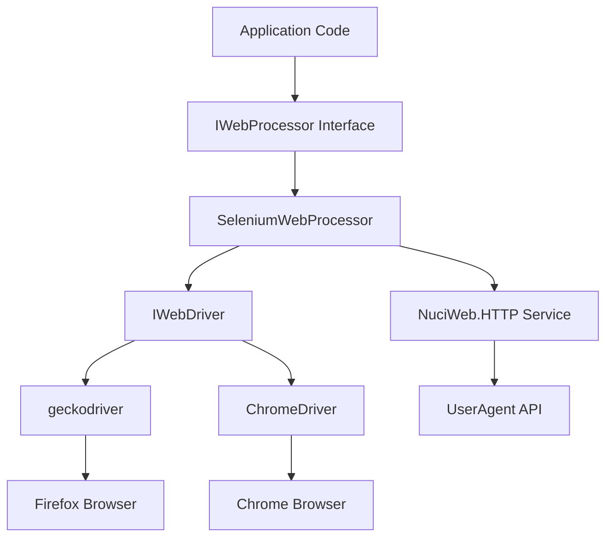

# Architecture

## Purpose

Provides a high-level overview of the NuciWeb.Automation.Selenium architecture, complementing the root ARCHITECTURE.md with implementation details.

## Overview

NuciWeb.Automation.Selenium implements the `IWebProcessor` abstraction from `NuciWeb.Automation` using Selenium WebDriver. The architecture follows a layered pattern with clear separation between the abstraction layer and the Selenium implementation.

## Key Components

### SeleniumWebProcessor

The primary implementation of `IWebProcessor`. It wraps a Selenium WebDriver instance and provides:

- Navigation operations (GoToUrl, Refresh)
- Element interaction (Click, SetText, MoveToElement)
- State queries (DoesElementExist, IsElementVisible, IsCheckboxChecked, IsSelected)
- Text and attribute retrieval (GetText, GetAttribute, GetSelectedText, GetSelectOptionsCount)
- Script execution (ExecuteScript, GetPageSource)
- Tab management (NewTab, SwitchToTab, CloseTab)
- Alert handling (AcceptAlert, DismissAlert)
- Iframe navigation (SwitchToIframe)

### WebDriverInitialiser

A static utility class that creates configured WebDriver instances:

- Automatic browser detection (Firefox preferred, Chrome fallback)
- Configurable debug mode (disables headless)
- Configurable page load timeout
- User agent fetching via NuciWeb.HTTP service

## Architecture Diagram

## Design Patterns

### Adapter Pattern

`SeleniumWebProcessor` acts as an adapter between the `IWebProcessor` abstraction and the Selenium WebDriver implementation. This allows:

- Swapping implementations without changing application code
- Testing with mock implementations
- Future support for alternative automation frameworks

### Factory Pattern

`WebDriverInitialiser` implements a factory pattern for WebDriver creation:

- Encapsulates driver configuration logic
- Provides automatic browser detection
- Centralises timeout and debug mode configuration

### Static Utility

`WebDriverInitialiser` is a static class because:

- No instance state is required
- Driver creation is a stateless operation
- Provides simple, direct access without instantiation

## Dependencies

### Direct Dependencies

| Dependency | Version | Purpose |
|------------|---------|---------|
| NuciWeb | 4.0.0 | Core framework |
| NuciWeb.Automation | 1.0.0 | IWebProcessor abstraction |
| NuciWeb.HTTP | 1.5.0 | User agent fetching |
| Selenium.Support | 4.5.1 | WebDriver utilities |
| Selenium.WebDriver | 4.5.1 | Browser automation |

### External Dependencies

- **geckodriver** - Firefox WebDriver (optional)
- **ChromeDriver** - Chrome WebDriver (optional)
- **Firefox Browser** - For geckodriver execution
- **Chrome Browser** - For ChromeDriver execution

## Thread Safety

### SeleniumWebProcessor

**Not thread-safe.** Each instance should be used by a single thread. For concurrent operations:

1. Create separate processor instances per thread
2. Use separate WebDriver instances per thread
3. Implement your own synchronisation if sharing is required

### WebDriverInitialiser

**Thread-safe.** Static methods can be called concurrently without synchronisation.

## Error Handling

The library throws standard Selenium exceptions:

- `NoSuchElementException` - Element not found
- `StaleElementReferenceException` - Element no longer attached to DOM
- `TimeoutException` - Operation timed out
- `WebDriverException` - General WebDriver errors

See [error-handling.md](./error-handling.md) for detailed error taxonomy.

## Configuration

### WebDriverInitialiser Parameters

| Parameter | Type | Default | Description |
|-----------|------|---------|-------------|
| isDebugModeEnabled | bool | false | Disables headless mode when true |
| pageLoadTimeout | int | 90 | Maximum seconds to wait for page load |

### Browser Selection Logic

1. Check for `geckodriver` at `/usr/bin/geckodriver`
2. If found, use Firefox driver
3. Otherwise, use Chrome driver
4. If neither driver is found, throw exception

## Related Documentation

- [repository-structure.md](./repository-structure.md) - Source tree layout
- [quick-start.md](./quick-start.md) - Getting started guide
- [api-reference/selenium-web-processor.md](./api-reference/selenium-web-processor.md) - Processor API reference
- [api-reference/web-driver-initialiser.md](./api-reference/web-driver-initialiser.md) - Initialiser API reference
- [design-decisions.md](./design-decisions.md) - Key design choices and rationale