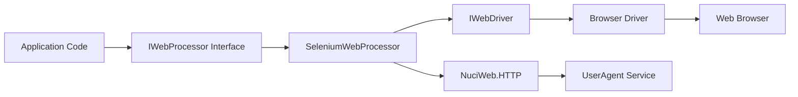

# Data Model

## Purpose

Documents the domain entities, relationships, and data structures used by the NuciWeb.Automation.Selenium library.

## Overview

The library is a thin adapter layer over Selenium WebDriver. It does not define its own domain entities or data models. Instead, it relies on:

1. **IWebProcessor interface** - Defined in NuciWeb.Automation
2. **Selenium WebDriver types** - From Selenium.WebDriver and Selenium.Support
3. **NuciWeb types** - From the NuciWeb framework

## Core Types

### IWebProcessor (External)

Defined in `NuciWeb.Automation` package. The interface that `SeleniumWebProcessor` implements.

**Key Methods:**
- `GoToUrl(string url)` - Navigate to URL
- `Refresh()` - Refresh current page
- `Click(string xpath)` - Click element by XPath
- `SetText(string xpath, string text)` - Set text in element
- `DoesElementExist(string xpath)` - Check element existence
- `IsElementVisible(string xpath)` - Check element visibility
- `IsCheckboxChecked(string xpath)` - Check checkbox state
- `IsSelected(string xpath)` - Check selection state
- `GetText(string xpath)` - Get text from elements
- `GetAttribute(string xpath, string attributeName)` - Get attribute values
- `GetSelectedText(string xpath)` - Get selected option text
- `GetSelectOptionsCount(string xpath)` - Count select options
- `ExecuteScript(string script)` - Execute JavaScript
- `GetPageSource()` - Get page HTML source
- `MoveToElement(string xpath)` - Move mouse to element
- `NewTab(string url)` - Open new tab
- `SwitchToTab(string tabId)` - Switch to tab
- `CloseTab(string tabId)` - Close tab
- `AcceptAlert()` - Accept alert dialog
- `DismissAlert()` - Dismiss alert dialog
- `SwitchToIframe(string xpath)` - Switch to iframe

### SeleniumWebProcessor

The concrete implementation of `IWebProcessor`.

**Constructor:**
- `SeleniumWebProcessor(IWebDriver driver)` - Wraps a WebDriver instance

**Dependencies:**
- `IWebDriver` - Selenium WebDriver instance
- `WebDriverWait` - Used internally for explicit waits

### WebDriverInitialiser

Static utility class for WebDriver creation.

**Methods:**
- `InitialiseAvailableWebDriver(bool isDebugModeEnabled, int pageLoadTimeout)` - Auto-detect browser
- `InitialiseFirefoxDriver(bool isDebugModeEnabled, int pageLoadTimeout)` - Create Firefox driver
- `InitialiseChromeDriver(bool isDebugModeEnabled, int pageLoadTimeout)` - Create Chrome driver

## Data Flow

## Return Types

### IEnumerable<string>

Used by methods that return multiple values:

- `GetText(string xpath)` - Returns text from all matching elements
- `GetAttribute(string xpath, string attributeName)` - Returns attribute values from all matching elements
- `GetSelectedText(string xpath)` - Returns selected option text from all matching elements

### string

Used by methods that return single values:

- `ExecuteScript(string script)` - Returns script execution result
- `GetPageSource()` - Returns HTML source
- `NewTab(string url)` - Returns new tab identifier

### bool

Used by state query methods:

- `DoesElementExist(string xpath)`
- `IsElementVisible(string xpath)`
- `IsCheckboxChecked(string xpath)`
- `IsSelected(string xpath)`

### int

Used by count methods:

- `GetSelectOptionsCount(string xpath)`

## XPath Usage

All element location uses XPath expressions:

- **Absolute paths:** `/html/body/div[1]/span`
- **Relative paths:** `//div[@class='content']`
- **Attribute selectors:** `//input[@name='username']`
- **Text selectors:** `//button[text()='Submit']`

## Constants

### WebDriverInitialiser

| Constant | Value | Description |
|----------|-------|-------------|
| `DefaultBrowserSize` | `new Size(1920, 1080)` | Default browser window size |
| `FirefoxDriverPath` | `/usr/bin/geckodriver` | Default Firefox driver location |

## Persistence

The library does not persist any data:

- No database interactions
- No file system writes (except build artifacts)
- No session state management
- No caching of element references

## Related Documentation

- [architecture.md](./architecture.md) - Architecture overview
- [api-reference/selenium-web-processor.md](./api-reference/selenium-web-processor.md) - Processor API
- [api-reference/web-driver-initialiser.md](./api-reference/web-driver-initialiser.md) - Initialiser API
- [state-and-persistence.md](./state-and-persistence.md) - State management
- [invariants.md](./invariants.md) - System invariants