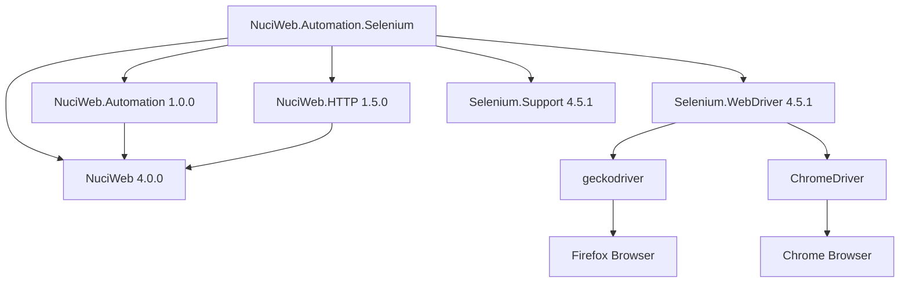

# Dependencies

## Purpose

Documents the external and internal dependencies of the NuciWeb.Automation.Selenium library.

## Internal Dependencies

### NuciWeb.Automation

- **Version:** 1.0.0
- **Purpose:** Provides the `IWebProcessor` interface abstraction
- **Usage:** `SeleniumWebProcessor` implements this interface
- **Package:** NuGet package

### NuciWeb

- **Version:** 4.0.0
- **Purpose:** Core NuciWeb framework
- **Usage:** Base framework for the automation library
- **Package:** NuGet package

### NuciWeb.HTTP

- **Version:** 1.5.0
- **Purpose:** HTTP utilities for fetching user agent strings
- **Usage:** Used by `WebDriverInitialiser` to fetch Chrome user agent
- **Package:** NuGet package

## External Dependencies

### Selenium.WebDriver

- **Version:** 4.5.1
- **Purpose:** Browser automation protocol implementation
- **Usage:** Core WebDriver interface (`IWebDriver`, `IWebElement`, etc.)
- **Package:** NuGet package
- **License:** Apache License 2.0

### Selenium.Support

- **Version:** 4.5.1
- **Purpose:** WebDriver support utilities
- **Usage:** Additional Selenium utilities and helpers
- **Package:** NuGet package
- **License:** Apache License 2.0

## System Dependencies

### Browser Drivers

#### geckodriver (Firefox)

- **Executable:** `geckodriver`
- **Default Location:** `/usr/bin/geckodriver`
- **Required For:** Firefox browser automation
- **Installation:** Download from https://github.com/mozilla/geckodriver/releases

#### ChromeDriver (Chrome)

- **Executable:** `chromedriver`
- **Required For:** Chrome browser automation
- **Installation:** Download from https://sites.google.com/a/chromium.org/chromedriver/

### Web Browsers

#### Firefox

- **Required For:** Firefox automation via geckodriver
- **Installation:** System package manager or official installer

#### Chrome

- **Required For:** Chrome automation via ChromeDriver
- **Installation:** System package manager or official installer

## Dependency Graph



## Version Compatibility

### .NET Version

- **Target Framework:** net10.0
- **Minimum Runtime:** .NET 10.0

### Selenium Version

- **Version:** 4.5.1
- **Compatibility:** WebDriver protocol W3C compliant
- **Browser Support:** Firefox 52+, Chrome 64+

### NuciWeb Version

- **Version:** 4.0.0
- **Compatibility:** Requires NuciWeb.Automation 1.0.0

## Dependency Management

### Package References

Defined in `NuciWeb.Automation.Selenium.csproj`:

```xml
<ItemGroup>
  <PackageReference Include="NuciWeb" Version="4.0.0" />
  <PackageReference Include="NuciWeb.Automation" Version="1.0.0" />
  <PackageReference Include="NuciWeb.HTTP" Version="1.5.0" />
  <PackageReference Include="Selenium.Support" Version="4.5.1" />
  <PackageReference Include="Selenium.WebDriver" Version="4.5.1" />
</ItemGroup>
```

### Lock File

- **File:** `obj/project.assets.json`
- **Purpose:** Records exact versions of all transitive dependencies
- **Generated:** During `dotnet restore`

## Transitive Dependencies

The following are transitive dependencies (not directly referenced):

- `Microsoft.NETCore.App` - .NET runtime
- `System.Text.Json` - JSON serialization (via NuciWeb)
- `System.Net.Http` - HTTP client (via NuciWeb.HTTP)

## Related Documentation

- [architecture.md](./architecture.md) - Architecture overview
- [repository-structure.md](./repository-structure.md) - Repository layout
- [build-and-deployment.md](./build-and-deployment.md) - Build configuration
- [configuration.md](./configuration.md) - Configuration options
- [integrations.md](./integrations.md) - External system integrations