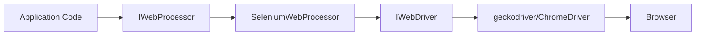

# Integrations

## Purpose

Documents the external system integrations used by the NuciWeb.Automation.Selenium library.

## Integration Overview

The library integrates with several external systems:

1. **Selenium WebDriver** - Browser automation protocol
2. **NuciWeb.HTTP** - HTTP service for user agent fetching
3. **Browser Drivers** - geckodriver and ChromeDriver
4. **Web Browsers** - Firefox and Chrome

## Selenium WebDriver Integration

### Purpose

Provides the core browser automation functionality.

### Integration Points

- `SeleniumWebProcessor` wraps `IWebDriver` instances
- All element interactions use WebDriver methods
- Navigation, clicking, text input, and state queries are delegated to WebDriver

### Configuration

- **Package:** Selenium.WebDriver 4.5.1
- **License:** Apache License 2.0
- **Protocol:** W3C WebDriver standard

### Failure Modes

- Driver not found
- Browser not installed
- Timeout during operations
- Invalid element selectors

## NuciWeb.HTTP Integration

### Purpose

Provides HTTP client functionality for fetching user agent strings.

### Integration Points

- `WebDriverInitialiser` calls `UserAgentFetcher.GetUserAgent().Result`
- Used during Chrome driver initialisation
- Provides realistic browser identification

### Configuration

- **Package:** NuciWeb.HTTP 1.5.0
- **Endpoint:** UserAgentFetcher service

### Failure Modes

- Service unavailable
- Network timeout
- Invalid response format

## Browser Driver Integration

### geckodriver (Firefox)

- **Executable:** `geckodriver`
- **Default Location:** `/usr/bin/geckodriver`
- **Purpose:** Bridges Selenium WebDriver to Firefox browser
- **Configuration:** Automatic detection

### ChromeDriver (Chrome)

- **Executable:** `chromedriver`
- **Purpose:** Bridges Selenium WebDriver to Chrome browser
- **Configuration:** Fallback when geckodriver not found

## Web Browser Integration

### Firefox

- **Purpose:** Browser automation via geckodriver
- **Headless:** Supported via driver options
- **Debug Mode:** Disables headless when enabled

### Chrome

- **Purpose:** Browser automation via ChromeDriver
- **Headless:** Supported via driver options
- **Debug Mode:** Disables headless when enabled
- **User Agent:** Fetched via NuciWeb.HTTP service

## Integration Patterns

### Adapter Pattern

`SeleniumWebProcessor` adapts `IWebDriver` to `IWebProcessor`:



### Dependency Chain

```
Application Code
  → IWebProcessor (NuciWeb.Automation)
    → SeleniumWebProcessor (NuciWeb.Automation.Selenium)
      → IWebDriver (Selenium.WebDriver)
        → geckodriver / ChromeDriver
          → Firefox / Chrome Browser
```

## Related Documentation

- [architecture.md](./architecture.md) - Architecture overview
- [dependencies.md](./dependencies.md) - Dependency management
- [configuration.md](./configuration.md) - Configuration options
- [troubleshooting.md](./troubleshooting.md) - Integration issues